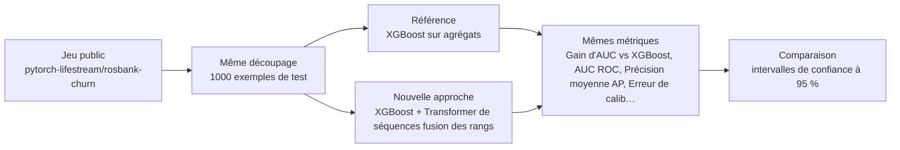
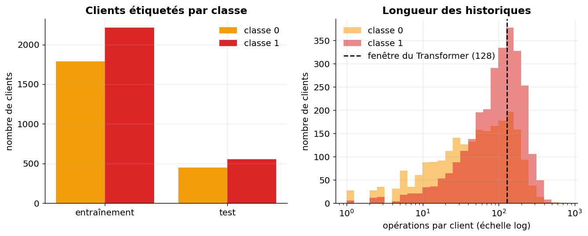
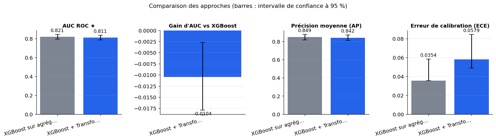
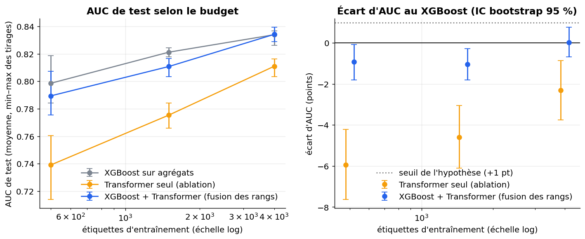
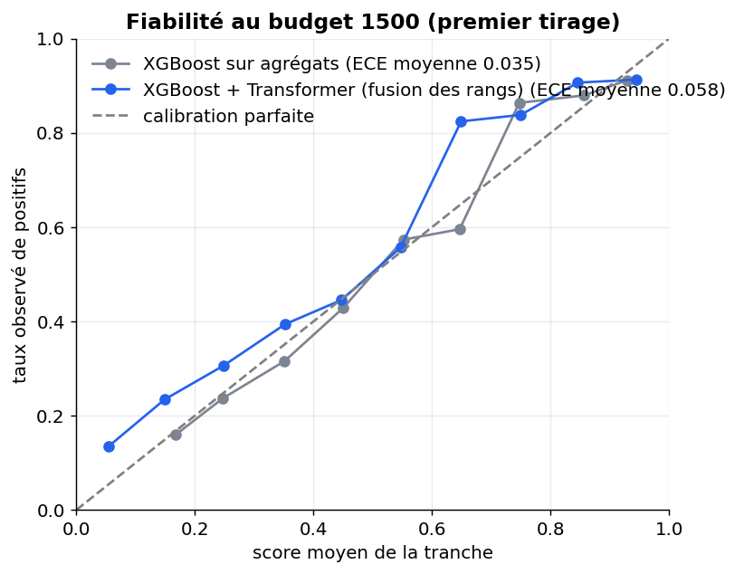
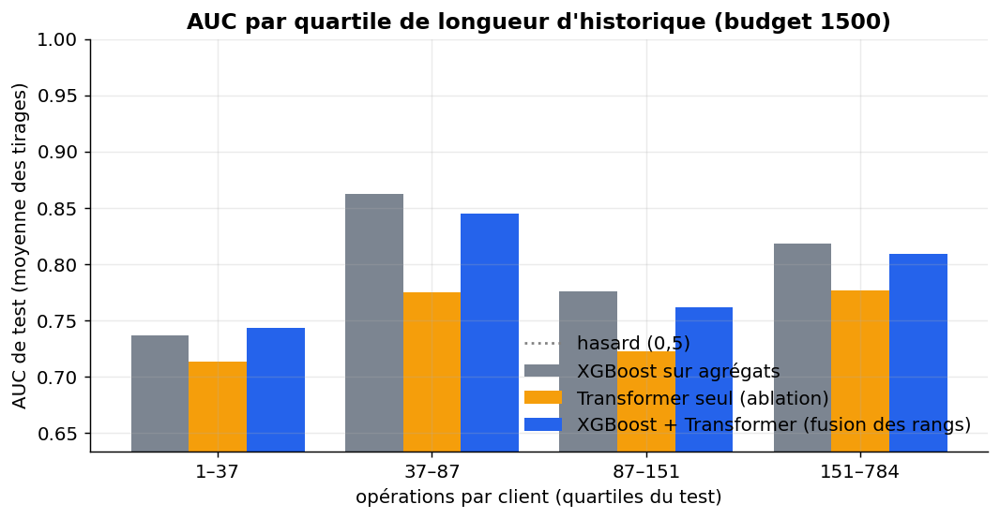

# Un petit Transformer de séquences de transactions, fusionné à un boosting sur agrégats, ajoute-t-il de l'AUC selon le budget d'étiquettes ?

> **En bref.** Sur ce jeu public, la fusion avec un petit Transformer n'améliore pas le boosting sur agrégats et le dégrade légèrement avec peu d'étiquettes. Le gain annoncé n'est pas reproduit, avec la réserve d'un réseau non réglé. AUC ROC : 0,811 [0,786 ; 0,837] pour XGBoost + Transformer (fusion des rangs), contre 0,821 [0,796 ; 0,846] pour XGBoost sur agrégats (1000 exemples de test, échelle complète).

## Sommaire

1. [La question](#la-question)
2. [Le protocole](#le-protocole)
3. [Les résultats](#les-résultats)
4. [Ce qu'il faut retenir](#ce-quil-faut-retenir)
5. [Rejouer l'expérience](#rejouer-lexpérience)
6. [Contenu du dépôt](#contenu-du-dépôt)
7. [Références](#références)
8. [Glossaire](#glossaire)

## La question

Les modèles qui lisent l'historique des opérations d'un client, une à une et dans l'ordre, font-ils mieux que la méthode habituelle ? Cette méthode habituelle résume l'historique en totaux et en moyennes, puis le confie à un modèle d'arbres de décision (XGBoost). On teste ici une combinaison des deux : un petit réseau de neurones lit les 128 dernières opérations, puis on fait la moyenne de son classement des clients et de celui de XGBoost. La comparaison se fait sur un jeu public de transactions carte, où il faut prédire le départ des clients, avec peu d'exemples étiquetés (quelques centaines), puis avec tous. Elle permet de décider si cette branche « séquence » mérite un essai sur des données internes, ou si les agrégats suffisent.

**Hypothèse testée.** La moyenne des rangs d'un XGBoost sur agrégats et d'un Transformer de 0,4 M de paramètres pré-entraîné puis ajusté gagne ≥ +1 point d'AUC médian sur XGBoost seul avec 500 et 1 500 étiquettes, avec un intervalle bootstrap au-dessus de zéro, et le gain fond avec toutes les étiquettes.

| | Référence | Nouvelle approche |
|---|---|---|
| **Approche** | XGBoost sur agrégats | XGBoost + Transformer de séquences (fusion des rangs) |
| **Principe** | Gradient boosting sur agrégats par client (comptes, sommes, moyennes par catégorie, fréquences de transition). | Un petit Transformer lit les 128 derniers événements, pré-entraîné sans étiquette (événements masqués) sur tous les clients, ajusté sur l'étiquette ; son rang de score est moyenné avec celui du XGBoost. |
| **Mise en œuvre** | xgboost XGBClassifier, 300 arbres max, profondeur 4, learning_rate 0.05, subsample 0.8, arrêt précoce sur validation ; agrégats par client : nombre, somme et moyenne des montants, par catégorie d'opération et par type de commerçant, fenêtres sur les 30 et 60 derniers jours, compteurs de transitions de catégories. | PyTorch : embeddings de catégorie d'opération, de commerçant et de canal + montant normalisé (log) + intervalle de temps ; 2 couches, 4 têtes, dimension 96 (~0,4 M de paramètres) ; pré-entraînement par prédiction de la catégorie masquée (15 %), 5 époques ; ajustement 10 époques, AdamW lr 1e-3 ; fusion par moyenne des rangs normalisés sur le test. |
| **Modèles** | — | — |

## Le protocole



- **Données** : [`pytorch-lifestream/rosbank-churn`](https://huggingface.co/datasets/pytorch-lifestream/rosbank-churn) (configuration `train`), évaluation sur le découpage `train` (1000 exemples). Séquences de transactions carte réelles avec une cible de départ du client : proche de l'appétence produit et de l'attrition, avec des séquences non étiquetées exploitables. Le split Hub unique « train » est partitionné par client dans le notebook : test fixe de 20 % des clients étiquetés (stratifié), le reste pour l'entraînement ; tous les clients servent au pré-entraînement sans étiquette.
- **Écarts avec des données réelles** : entreprise russe, environ 10 000 clients sur ~3 mois, découpage par client et non hors période (période trop courte), pas de variables métier riches, licence non précisée sur le Hub, pas de fraude ni de blanchiment.
- **Déroulé** : Jeu public pytorch-lifestream/rosbank-churn (transactions carte, cible de départ du client), dont le split unique est partitionné par client. Le test fixe réunit 20 % des clients étiquetés, tirés en stratifiant sur la cible. Les budgets d'étiquettes sont tirés dans les 80 % restants. Tous les clients hors test servent au pré-entraînement sans étiquette. Pour chaque budget, des tirages appariés donnent les mêmes clients au XGBoost (300 arbres, profondeur 4, arrêt précoce sur 15 % du budget) et au Transformer (2 couches, 4 têtes, dimension 96, pré-entraîné par masquage puis ajusté avec AdamW). La fusion est la moyenne des rangs normalisés sur le test. On rapporte l'AUC ROC (métrique principale), la précision moyenne, l'écart d'AUC apparié au XGBoost et l'ECE, avec des intervalles bootstrap à 95 % sur les clients de test, ainsi que la latence par client.
- **Deux échelles, un seul code** : l'échelle réduite (300 exemples, CPU, 1 min) valide la mécanique ; l'échelle complète (GPU T4 (Google Colab), 3 min) donne les résultats.



*À gauche, les clients étiquetés par classe dans l'entraînement et le test : les proportions doivent être proches. À droite, le nombre d'opérations par client, par classe (échelle log). Au-delà du pointillé, le Transformer ne lit que les 128 dernières opérations.*

**Les métriques**

| Métrique | Ce qu'elle mesure | Meilleur si |
|---|---|---|
| AUC ROC ★ | Probabilité qu'un client positif tiré au hasard soit classé au-dessus d'un client négatif tiré au hasard (0,5 = hasard, 1 = parfait). | plus haut |
| Précision moyenne (AP) | Qualité du haut de la liste triée par score ; un score constant obtient le taux de positifs du test. | plus haut |
| Gain d'AUC vs XGBoost | Écart d'AUC apparié entre l'approche et le XGBoost sur les mêmes clients et les mêmes tirages ; sans objet (None) pour la référence elle-même. | plus haut |
| Erreur de calibration (ECE) | Écart moyen entre le score et le taux réel de positifs par tranche de score ; il dit si le score peut se lire comme une probabilité (ce n'est pas le cas de la fusion des rangs). | plus bas |

★ métrique principale : c'est elle qui tranche la question.

## Les résultats

| Approche | Gain d'AUC vs XGBoost ↑ | AUC ROC ★ ↑ | Précision moyenne (AP) ↑ | Erreur de calibration (ECE) ↓ | Latence médiane (ms) ↓ |
|---|---|---|---|---|---|
| XGBoost sur agrégats (référence) | — | **0,821 [0,796 ; 0,846]** | **0,849 [0,818 ; 0,879]** | **0,0354 [0,0376 ; 0,0584]** | 0,01 |
| XGBoost + Transformer (fusion des rangs) (nouvelle approche) | -0,0104 [-0,0179 ; -0,00272] | 0,811 [0,786 ; 0,837] | 0,842 [0,811 ; 0,873] | 0,0579 [0,0489 ; 0,0845] | 0,1 |

★ métrique principale · ↑ plus haut = meilleur · ↓ plus bas = meilleur · entre crochets : intervalle de confiance à 95 % (bootstrap) · en gras : la meilleure valeur.



*Valeur de chaque métrique par approche (★ : métrique principale, à maximiser) ; les barres d'erreur donnent l'intervalle de confiance à 95 % sur 1000 exemples de test.*



*À gauche, l'AUC de test des trois approches selon le nombre d'étiquettes (moyenne et étendue des tirages). À droite, l'écart d'AUC au XGBoost avec son intervalle bootstrap apparié : un intervalle qui coupe zéro signifie que le gain n'est pas établi.*



*Diagramme de fiabilité : par tranche de score, taux réel de positifs. Sur la diagonale, le score se lit comme une probabilité. La fusion produit des rangs, pas des probabilités : son écart à la diagonale est attendu et impose une recalibration avant tout seuil exprimé en probabilité.*



*AUC de test par quartile du nombre d'opérations par client. Un écart entre les barres orange (fusion) et bleues (XGBoost) qui varie d'un quartile à l'autre indique où le réseau apporte ; chaque groupe ne compte qu'un quart du test, les écarts sont donc fragiles.*

**Lecture** (confiance moyenne). À l'échelle complète (tout le jeu public, GPU T4, budgets de 500 et 1 500 étiquettes, 5 tirages appariés), la fusion des rangs n'améliore pas le XGBoost sur agrégats. Au budget de 1 500 étiquettes, l'AUC est de 0,811 contre 0,821, soit −1,04 pt, avec un intervalle bootstrap entièrement négatif [−1,79 ; −0,27]. Avec toutes les étiquettes, l'écart est nul (+0,03 pt, intervalle [−0,67 ; +0,78]). Le Transformer seul (0,775) est nettement en dessous du XGBoost, donc la moyenne à poids égaux dégrade la meilleure branche. Le gain d'environ +1 pt observé à l'échelle réduite n'était que du bruit d'échantillonnage. Le gain de +2,1 pts de la source n'est pas retrouvé ici, mais le protocole diffère (autres données, réseau non réglé, test non hors période), et l'intervalle ne couvre que l'échantillonnage du test.

## Ce qu'il faut retenir

**Réserves**

- Le gain apparent à petite échelle disparaît, et s'inverse, sur le jeu complet. Il faut ne retenir que le résultat à l'échelle complète.
- Le résultat négatif concerne un petit réseau non réglé fusionné à poids égaux. Il ne prouve pas qu'aucune configuration de séquences n'aiderait, mais aucun gain n'est établi ici.
- Les intervalles sous-estiment l'incertitude totale. Le sens du résultat (aucun gain) est plausible, mais sa précision l'est moins.

**Limites**

- Le jeu public couvre environ 3 mois seulement. Le découpage se fait donc par client et non hors période, ce qui peut surestimer les performances par rapport à un test sur une période future.
- La date de coupure est reconstruite (lendemain de la dernière opération) et les dates sont au jour près. Les compteurs de transitions à 1 h et 24 h y sont donc approximatifs.
- La référence n'utilise que des agrégats génériques, sans variables métier riches ni réglage fin des hyperparamètres. Face à un modèle en production, l'écart pourrait être plus faible.
- Le score fusionné est un rang calculé sur le lot noté : il n'est pas calibré et dépend de la composition du lot.
- À l'échelle réduite, le test compte quelques centaines de clients. Les intervalles sont larges et l'analyse par quartile de longueur n'est qu'indicative.

**Pistes d'amélioration**

- L'écart d'ECE entre la fusion et le XGBoost ne dit rien sur la qualité de la fusion : un rang n'est pas une probabilité. Les intervalles d'ECE sont à ignorer.
- Avec toutes les étiquettes, la fusion est équivalente au XGBoost (l'intervalle contient zéro). Cela ne montre pas une hausse du gain avec les étiquettes.
- Le jeu est court et le découpage n'est pas hors période : les AUC se transposent mal à un scénario de production réel, et les chiffres de la source ne sont pas directement comparables.
- Le rapport de latence (environ 10 fois) dépend du matériel et du lot. C'est un ordre de grandeur seulement.

## Rejouer l'expérience


### Sur le jeu public

```bash
pip install -r requirements.txt
jupyter lab experiment.ipynb
```

Dans la cellule de paramètres : `PHASE = "public"`, puis `SCALE = "reduced"` (quelques minutes sur CPU, pour vérifier) ou `SCALE = "full"` (résultats publiés ; GPU T4 (Google Colab), 3 min). Les résultats sont écrits dans `outputs/results_public.json`, les figures dans `outputs/figures/` (les résultats publiés en sont une copie, dans `results/` et `figures/`).

### Sur vos données (environnement de services financiers)

Le même protocole, sur vos données, dans votre environnement : seule la cellule `PRIVATE_CONFIG` s'adapte. Le code de cette phase a été exécuté de bout en bout sur un jeu factice écrit comme un vrai export (dossier de fichiers, CSV « ; » en Windows-1252, colonnes à faire correspondre), contre un service simulé à la convention OpenAI (clé lue dans un fichier de secret), modèles chargés hors ligne.

**1. Préparer le jeu de données.** Colonnes attendues (les noms peuvent différer : on les fait correspondre dans `PRIVATE_CONFIG["columns"]`) :

| Colonne attendue | Type | Contenu |
|---|---|---|
| `client_id` | string | Identifiant client pseudonymisé |
| `event_time` | datetime | Horodatage de l'opération |
| `amount` | float | Montant signé |
| `event_type` | string | Type d'opération (carte, virement, prélèvement…) |
| `merchant_category` | string | Catégorie du commerçant ou de la contrepartie |
| `channel` | string | Canal (agence, mobile, internet…) |
| `target` | int | 1 si le client souscrit le produit dans le mois suivant la date de coupure, sinon 0 ; vide si inconnu |
| `cutoff_date` | date | Date de coupure de l'observation |

Volume conseillé : ≥ 50 000 clients sur ≥ 12 mois, ≥ 500 positifs par produit ; séquences non étiquetées pour tous les clients.

**Conditions pour que la comparaison soit concluante**

- Une date de coupure par client ; agrégats et séquences construits uniquement avec des événements antérieurs à la coupure.
- Test hors période : coupures les plus récentes (≥ 2 mois) jamais vues à l'entraînement ni au pré-entraînement.
- ≥ 500 positifs par produit dans l'entraînement et ≥ 200 dans le test.
- ≥ 12 mois d'historique pour capter la saisonnalité.
- Comparer à la baseline en production, réglée et avec toutes ses variables métier, pas seulement aux agrégats génériques.
- Pseudonymiser les identifiants et retirer libellés libres et contreparties nominatives.

**Constituer l'extraction.** Extraire les opérations des comptes et cartes des clients particuliers sur la période, joindre les souscriptions de produits pour fabriquer la cible à chaque date de coupure, filtrer les clients sans historique minimal, puis échantillonner par client en respectant la chronologie.

**2. Rendre les modèles disponibles hors ligne** (si l'environnement n'a pas accès à Internet) :

```bash
python download_models.py ./models --scale full   # sur un poste connecté
```

puis copier le dossier dans l'environnement et le désigner par `LOCAL_MODELS_DIR`. Les révisions téléchargées sont celles des résultats publiés.

**3. Configurer** l'environnement du notebook à partir de `private.env.example` (ou directement la cellule `PRIVATE_CONFIG`). Jamais de clé dans le notebook : une variable, un fichier de secret monté ou la saisie masquée.

| Variable | Rôle |
|---|---|
| `PRIVATE_DATA` | jeu de données : fichier ou dossier (csv, tsv, parquet, jsonl, json, xlsx) ; `fake` pour tester le code sur un jeu factice |
| `LOCAL_MODELS_DIR` | (facultatif) dossier des poids copiés localement (`org--nom/`), pour travailler sans Internet |
| `HTTPS_PROXY, SSL_CERT_FILE, PIP_INDEX_URL` | (facultatif) proxy, autorité de certification et miroir PyPI d'entreprise |
| `SERVICE_TIMEOUT_S, SERVICE_MAX_RETRIES` | (facultatif) délai (120 s) et tentatives (3) par appel de service |

**4. Lancer** avec `PHASE = "private"` (et `SCALE = "full"`). La cellule d'initialisation affiche une liste de contrôle (jeu, colonnes, modèles, services) et s'arrête sur ce qui manque, avant tout calcul. Les résultats sont écrits dans `outputs/results_private.json` (avec versions, machine, graine et empreinte des données).

**5. Interpréter.** Métriques métier à suivre : AUC, précision et gain en tête de liste (top 5 % ciblé), taux de conversion simulé, stabilité entre périodes.

**Garde-fous.** Données pseudonymisées, aucune variable sensible (origine, santé) ; contrôle d'équité par tranche d'âge ; branche réseau non explicable, donc usage comme aide à la décision uniquement avec explication SHAP de la branche boosting. En phase `private`, le notebook refuse les services publics (OpenAI, Anthropic, Mistral, Hugging Face…) et le HTTP non chiffré, n'affiche aucune donnée brute et coupe la télémétrie des bibliothèques ; avec `LOCAL_MODELS_DIR`, il travaille sans accès à Internet.

## Contenu du dépôt

| Fichier | Contenu |
|---|---|
| `experiment.ipynb` | le notebook : question, données, deux approches, évaluation, analyse, bilan (sorties incluses) |
| `helpers.py` | fonctions communes : phases et échelles, services internes, lecture des données, mesures, figures |
| `results/results.json` | résultats publiés (échelle complète) : métriques, intervalles, latences, versions et machine |
| `results/results_reduced_scale.json` | résultats de l'échelle réduite (validation de la mécanique, CPU) |
| `figures/` | figures du notebook reprises dans ce README |
| `requirements.txt` | versions exactes des bibliothèques utilisées |
| `private.env.example` | variables d'environnement pour exécuter le notebook sur vos données |
| `download_models.py` | téléchargement des poids des modèles, pour un environnement sans Internet |

## Références

**Sources de l'approche**

- [How Much Do Foundation Models Add to Gradient Boosting on Financial Event Sequences?](https://arxiv.org/abs/2611.18914)

**Autres jeux de données examinés**

| Jeu | Accès | Intérêt | Pourquoi pas ici |
|---|---|---|---|
| [ai-lab/MBD-mini](https://huggingface.co/datasets/ai-lab/MBD-mini) | Hugging Face, libre | Jeu de la source, 4 cibles de propension produit. | Viewer désactivé, archives de 3,4 Go non chargeables en parquet. |
| [pytorch-lifestream/alfa-scoring-trx](https://huggingface.co/datasets/pytorch-lifestream/alfa-scoring-trx) | Hugging Face, libre | Scoring de défaut sur séquences. | 6,9 Go, cibles illisibles par le serveur de jeux, scoring crédit haut risque. |
| [eexzzm/IBM-Transactions-for-Anti-Money-Laundering-HI-Small-Trans](https://huggingface.co/datasets/eexzzm/IBM-Transactions-for-Anti-Money-Laundering-HI-Small-Trans) | Hugging Face, libre | AML sur transactions, 5 M de lignes. | Étiquettes par transaction, synthétique, hors du protocole par client. |
| [pytorch-lifestream/transactions-gender](https://huggingface.co/datasets/pytorch-lifestream/transactions-gender) | Hugging Face, libre | Séquences avec cible genre. | Cible sans lien métier. |

**Licences**

- Jeu de données `pytorch-lifestream/rosbank-churn` : voir sa fiche
- Vérifier la licence de chaque modèle avant tout usage au-delà de l'évaluation.

## Glossaire

| Terme | Définition |
|---|---|
| **Gradient boosting (XGBoost)** | Suite d'arbres de décision dans laquelle chaque nouvel arbre corrige les erreurs des précédents ; c'est le modèle de référence sur données tabulaires. |
| **Agrégats** | Résumés chiffrés de l'historique d'un client : nombre d'opérations, sommes et moyennes des montants, par catégorie et sur des fenêtres récentes. |
| **Transformer** | Réseau de neurones qui lit une séquence et pèse, pour chaque élément, l'importance des autres éléments (mécanisme d'attention). |
| **Pré-entraînement masqué** | Apprentissage sans étiquette : on cache une partie des opérations et le réseau doit les retrouver à partir de leur contexte. |
| **Fusion des rangs** | Combinaison de deux modèles par la moyenne des positions de chaque client dans leurs classements, ce qui évite de comparer des scores sur des échelles différentes. |
| **Point-in-time** | Règle qui ne garde que les informations connues avant la date de coupure, pour qu'aucune variable ne voie le futur. |
| **Arrêt précoce** | On arrête l'entraînement quand la performance sur un jeu de validation cesse de progresser, pour éviter le sur-apprentissage. |
| **Bootstrap apparié** | On retire au hasard, avec remise, des clients du test, les mêmes pour toutes les approches, afin de mesurer combien un chiffre ou un écart dépend de l'échantillon. |
| **Calibration** | Un score est calibré si, parmi les clients notés 0,3, environ 30 % sont réellement positifs. |
